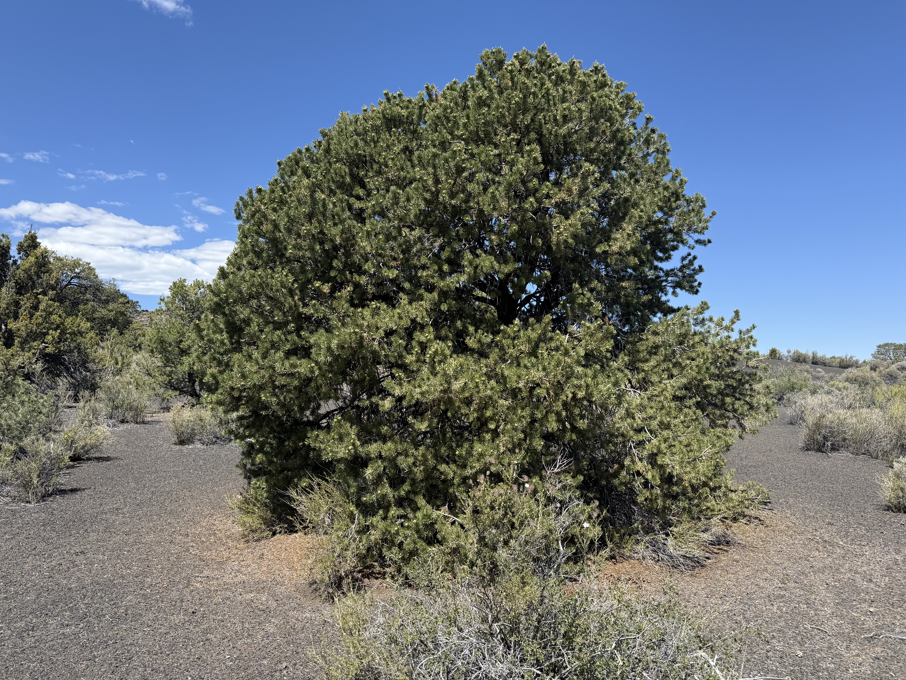
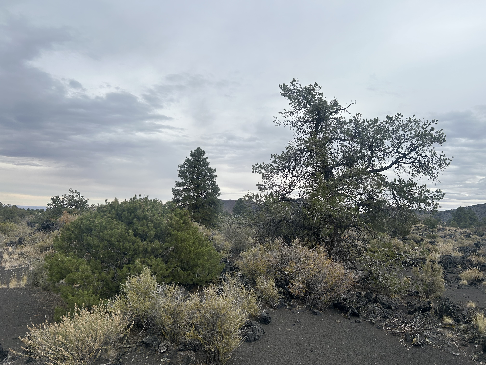
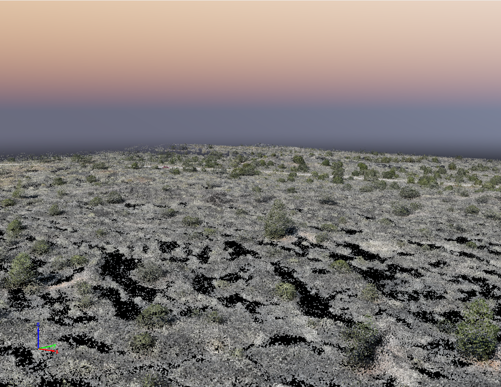
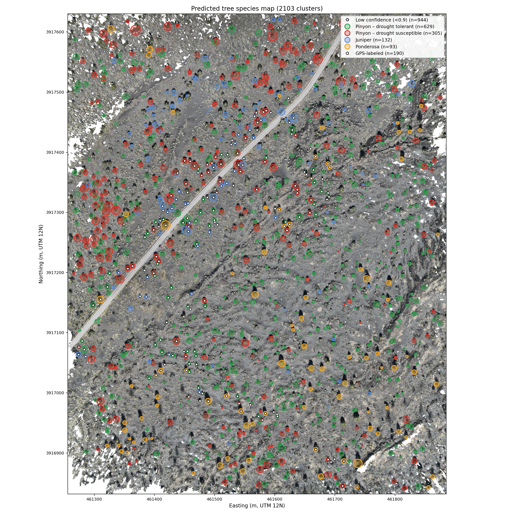
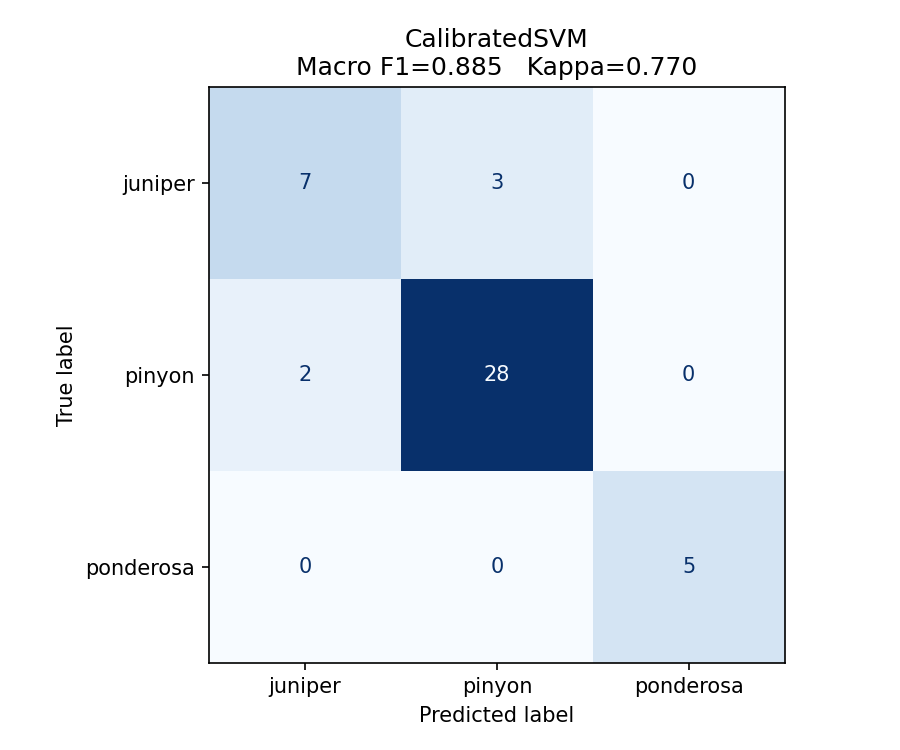
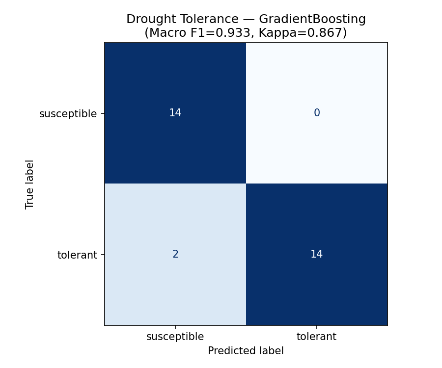
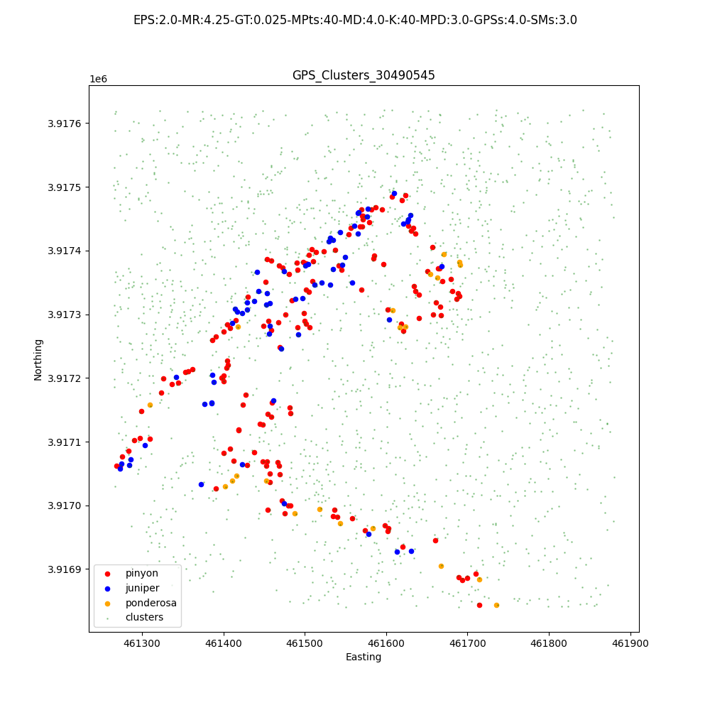
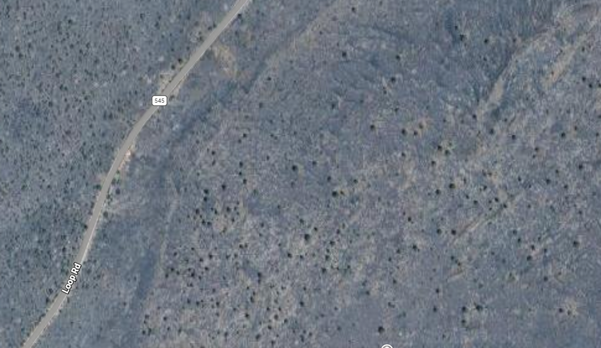

# Detecting Drought Resistant Pinyon Pines using Aerial Structure-from-Motion

A research project intended to identify drought-tolerant pinyon pines from drone-collected Structure-From-Motion pointclouds processed using PixMapper4D. Currently, data has only been collected from a field site at **Sunset Crater, AZ**. The processing is done on the **Monsoon** SLURM HPC cluster at Northern Arizona University. 

<div align="center">
  
</div>
 
>Above: A more drought tolerant pinyon pine at site A in Sunset Crater, AZ. Taken by myself. 
<br>

<div align="center">
  
</div>

> Above: A  drought tolerant pinyon pine on the left, and a  susceptible pinyon on the right. Taken by myself at site A in Sunset Crater, AZ. 

<br>
The pipeline takes in raw `.las` files, builds a Canopy Height Model, detects
tree tops as CHM peaks, segments individual crowns via watershed, matches
GPS-tagged ground-truth species to clusters, and trains a species classifier
on the labeled subset. All `.las` used have been exported from PixMapper4D.

<div align="center">
  
</div>

>Screenshot of Structure-from-motion pointcloud of site A in Sunset Crater, AZ. Visualized using PixMapper4D.

<br>
The project is split into two independent stages:

- **`clustering/`** — everything expensive: point cloud processing, CHM,
  watershed segmentation, GPS label matching. Run via `run_clustering.py`,
  usually swept over many parameter combinations to optimize the matching
  score. Depending on parameters, usually takes around 25 to 50 minutes (Not counting reading in .las files).

- **`modelling/`** — species classification on the labeled clusters, and drought tolerance on pinyons.
  `clustering/` produced. Run via `train_model.py`, fast enough to iterate
  on interactively.
  Takes a lot less time to run, usually less than 5 minutes. 

These used to be one script (`main.py`). They were split apart because clustering was taking too long and was not required for training the model. The main file became too cluttered, and was clearly two seperate parts. 

---
## AI Usage Disclaimer
All python and bash coding has been done by Anthropic's Claude Sonnet models (versions 4.x and 5.x). Some slight touch ups have been done by myself on code outputted from claude. The web browser version has been used, and outputs are copied into NAU's Monsoon's VSCode IDE.

---

## End Goals
Ultimately, accurate prediction maps contatining species information and pinyon drought tolerance will be output for any group of `.las` files inputted, without needing any GPS tags. On top of that, I would like to create a more interactive app that shows more in-depth information on potential trees. 

<div align="center">
  
</div>

>Example of prediction map output from train_model.py. Created Oct. 2026 

<br>
Prediction matrices below are from a run early Nov 2026, Macro F1 scores of 0.9 or higher are targeted. The first one is a specifier to distinguish between All Pinyons/Junipers/Ponderosas, then the one below is for pinyon drought classes. Multiple models get trained for specification with many performing well, and Multi-Layer Perceptron models performing the most consistently.


<div align="center">
  
  <br>
</div>


>Above: Specifier confusion matrix results of a Support Vector Machine model.

<br>
<div align="center">
  
  <br>
  <sub>
  (Params for matrices: MAX_RADIUS: 4.25
    MAX_DISTANCE: 5.0
    MIN_POINTS: 40
    MIN_PEAK_DISTANCE: 3.0
    K: 40
    MIN_HEIGHT: 0.5
    SEARCH_RADIUS_M: 2.5
    SMOOTH_SIGMA: 0.11
    EPS: 2.0
    GREEN_THRESHOLD: 0.025
    VOXEL_SIZE: 0.08
    GPS_SIGMA: 4.0
    CROWN_RADIUS: 8.0
    MIN_DENSITY_RATIO: 1.5
    USE_COLOR: False
    COLOR_WEIGHT: 10.0
    MIN_EXG: 0.05
    GREEN_FRACTION: 0.2
    MASK_CHM_FILLED: 0.3
    MIN_CLUSTER_HEIGHT: 1.5
    MIN_GPS_COVERAGE: 0.9
    GPS_COVERAGE_RADIUS: 6.0) </sub>
</div>
<br>

>Above: Pinyon drought class modelling results and parameters used. 

<br>
I would also like to write and publish a scientific paper about detecting drought tolerance in pinyons via SfM, as well as their predicted growing patterns across elevation gradients. 
<br>


## Repository Structure
(May not be completely up-to-date)
```
Pinyon-Detection/
├── README.md                 # this file
├── PIPELINE.md                # detailed stage-by-stage walkthrough
├── .gitignore                 # excludes generated point clouds, clusters, logs, venv
│
├── clustering/
│   ├── run_clustering.py      # entry point — clustering + GPS labeling
│   ├── constants.py           # STEPS flags, get_paths(trial_name)
│   ├── functions/              # io, preprocessing, detection, labeling
│   ├── shells/                 # pinyons.sh, pinyon_sweep.sh, Drive sync scripts
│   └── parameters/             # params.txt sweep grids
│
├── modelling/
│   ├── train_model.py         # entry point — classifier training
│   └── functions/              # features, classification
│
├── shells/                    # cross-cutting utilities
│   ├── train_model.sh
│   ├── setup_venv.sh
│   ├── debug.sh
│   ├── see_recent_jobs.sh
│   └── clear_garbage_files.sh
│
├── trial_data/
│   └── Sunset_sfm_trial/
│       ├── data/point_cloud/    # raw .las input files
│       ├── pointclouds/         # saved raw and cleaned .ply files
│       ├── CFMs/                # Canopy Height Model GeoTIFFs
│       ├── clusters/            # segmented tree clusters (.ply)
│       ├── labeled_clusters/    # clusters with GPS species labels
│       ├── multi_match_clusters/# clusters behind ambiguous GPS matches
│       ├── labels/              # GPS label CSVs
│       ├── dataframes/          # cached df_clusters / df_deep_clusters
│       ├── images/              # diagnostic plots
│       └── results/             # sweep result CSVs
│
└── results/                   # legacy aggregate CSVs from early manual trials
```

---

## Quick Start

### 1. Environment setup

```bash
bash shells/setup_venv.sh

module load miniforge3/26.3.2
source "$(conda info --base)/etc/profile.d/conda.sh"
conda activate open3d_env
```

Requires Python 3.10. Key dependencies: `open3d`, `numpy`, `scipy`,
`scikit-learn`, `rasterio`, `scikit-image`, `laspy`, `pyproj`, `pandas`,
`matplotlib`, `xgboost`. 

`.gitignore` excludes `open3d_env/` and every generated pipeline artifact
(point clouds, clusters, CHMs, dataframes, images, SLURM logs) — these are
all regenerable from a `run_clustering.py` run and get large fast and are mainly used for debugging, so they
stay out of git history. `results/` CSVs are small and are the actual
experiment record, so those stay tracked.

### 2. Configure paths and steps

Edit `clustering/constants.py`:
- `get_paths(trial_name)` — all input/output paths, derived from the trial name
  - `PATHS["DATA"]` needs to have the .las files to run, at least for the first time.
  - `PATHS["DSM"]` can have a DSM if one is available, if not it can get created. 
- `STEPS` — boolean flags controlling which clustering stages re-run
  - Steps can only be skipped after being ran at least once, so the data can be saved.

### 3. Run clustering + labeling

```bash
sbatch clustering/shells/pinyons.sh
```

See [`clustering/README.md`](clustering/README.md) for CLI args, the
`params.txt` sweep format, and current known quirks. Both `pinyons.sh` and `pinyon_sweep.sh` accept optional `-m` string arguments for notes along with the run, similar to `git commit -m`. 

Job results for both sweeps and individual jobs can be found in `trial_data/{trial_name}/GPS_results/`. Log files for debugging or any printed outputs from any job are in `clustering/logs/`.
### 4. Train the classifier

```bash
sbatch shells/train_model.sh
```

See [`modelling/README.md`](modelling/README.md) for the enhancement
toggles, the `--advanced` classifier comparison, and semi-supervised label
spreading.

### 5. (Optional) Do a full run
```
sbatch shells/run_full_pipeline.sh
```
Runs a clustering job then a modelling one, doing steps 3 and 4 with one script. Outputs of both sides go to `/run_outputs`, in a folder named `[TRIAL_NAME]_[JOB_ID]_[DATE]_[TIME]`. 

---

## Matching Score

`clustering/`'s output metric: the fraction of GPS-labeled trees with
exactly one detected cluster within `max_distance`.

<div align="center">
  
</div>

>Graph displaying clusters and labels collected from the field of site A in Sunset Crater, AZ. 

<br>
(Printed outputs from run_clustering.py below)

```
Perfect matches (1:1):   197  (83.5%)
No match:                26  (11.0%)
Multiple clusters:       13  (5.5%)
Matching score:          0.835
```

Best achieved on Sunset Crater so far: **~0.835**.

---

## The Data Bottleneck

The labeled dataset is small — **~236 labeled clusters**, with **ponderosa
at only ~20 samples** right now. This has been the fundamental constraint on
classifier performance; no model architecture, oversampling, weighting, or
feature engineering approach tried so far has overcome it. More labeled
ground-truth data, not a better classifier, is the highest-leverage next
step for the modelling side.

---

## Field Site

**Sunset Crater**, Arizona. The scan area covers a cinder cone with
significant terrain variation. The irregular drone flight
path means coverage is not a uniform rectangle — a `coverage_radius`
proximity filter in the label matcher handles the non-rectangular footprint.

Species present: pinyon pine, juniper, ponderosa pine.

<div align="center">
  
</div>

>Aerial screen shot of site A in Sunset Crater, AZ. Taken on Google Maps. 
<br>

## Debugging
 Individual instances of clustering jobs have `.txt` and `.err` files in `clustering/logs/`, and modelling job logs live in `modelling/logs/`. The `.txt` files have the progress of the job along with it's results and parameters. In `run_clustering.py`, the variable `SILENT` produces even more in-depth outputs when set to `True`. 

`run_full_pipeline.sh` puts its outputs in `trial_data/run_outputs/`, and each log file has clustering and modelling in the same file.

## To Do List 

- **Elevation Gradient/Large Flyover:** A final flyover covering a larger area over a more dramatic elevation gradient is an end goal idea to test final models. This would capture more and less  water stressed areas to possibly reveal patterns pinyon drought tolerance. This flyover could be a thin rectangle, or multiple flyights put together.
- **Seperate Overlapping Trees:** What I am currently working towards, there are a few trees that physically overlap that we gathered labels for. Overlapping trees are common, so having a method of seperation would be great. I am trying approaches based on seperating via hues, with some progress being made. After seperation, labels will need to be reassigned. 

- **Collect Thermal & Multispectral Data:** On top of the main research goal, looking at relationships between drought tolerance in pinyons and thermal & multipsectral data would be cool to explore. Hopefully multispectral data could be collected by December, but themal data may not be possible to get collected until warmer seasons. 


## See Also

- [`PIPELINE.md`](PIPELINE.md) — detailed walkthrough of every pipeline stage and functions. 